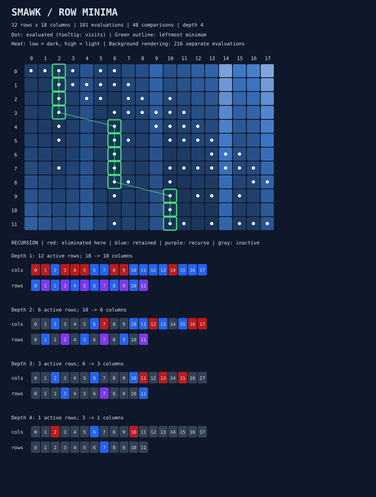

# smawk-row-minima

An on-demand, instrumented Rust implementation of **SMAWK**: find every row's
leftmost minimum in a totally monotone matrix using **O(m + n)** evaluations,
instead of the **O(mn)** evaluations needed by brute force.

Includes deterministic rectangular Monge matrices, an independent brute-force
oracle, exhaustive small-input checks, CSV benchmarks, and SVG explanations.
No external Rust dependencies or GitHub Actions/workflows.



## Run

Install a Rust toolchain supporting edition 2024 (Rust 1.85 or later).

```powershell
cargo test
cargo run --release -- verify --rows 100 --cols 150 --seed 42
cargo run --release -- visualize --rows 12 --cols 18 --seed 42 --out artifacts/example.svg
cargo run --release -- bench --sizes 64,256,1024 --seed 42 --repeats 5
```

Use `--help` to see the commands. Generated files belong in ignored `artifacts/`.
Visualization accepts 1 through 32 rows and columns. The solver has no such
dimension limit, subject to available memory and representable integer values.
All CLI searches are checked against brute force; consequently a complete CLI
run, including verification, takes O(mn) time. The measured SMAWK search remains
O(m+n). Benchmarks run square, tall, and wide shapes for each requested size.

## Matrix contract

```rust
use smawk_row_minima::{MongeMatrix, brute_force, smawk};

let matrix = MongeMatrix::seeded(100, 150, 42);
let fast = smawk(&matrix).unwrap();
let reference = brute_force(&matrix).unwrap();
assert_eq!(fast.minima, reference.minima);
// fast.minima[row] is the original column index of its leftmost minimum.
```

Implement `Matrix::{rows, cols, at}` for another implicit or stored matrix.
`at` returns an `i128`; entries must be deterministic. Constant-time evaluation
is required for the time bound. Zero rows produce an empty result; positive
rows with zero columns return `SearchError::NoColumns`.

For row minima, **total monotonicity** means that every submatrix has
nondecreasing leftmost row-minimum indices. Equivalently, for `a < b`, `c < d`:

```text
M(a,c) > M(a,d)  implies  M(b,c) > M(b,d)
```

Monotonicity of the full matrix's minima alone is insufficient. The solver
assumes total monotonicity and does not validate it. Unknown arbitrary matrices
may produce incorrect results; verify their structure or compare with brute force.

The supplied generator uses:

```text
M(i,j) = (i-j)^2 + costs[j]
```

Only the column costs are stored, using O(n) memory. Seeded generation uses
SplitMix64 with wrapping arithmetic and maps each output to `-100..=100` via
`output % 201 - 100`. `MongeMatrix::new` also accepts explicit `Vec<i64>` costs.
Evaluation uses checked `i128` arithmetic and panics if a value is unrepresentable.

The Monge rectangle difference is:

```text
M(a,c) + M(b,d) - M(a,d) - M(b,c) = -2(b-a)(d-c) <= 0
```

Column costs cancel. Thus every generated matrix is Monge, and therefore totally
monotone. `is_monge` directly checks all rectangles in O(m²n²) time and returns
an error if a corner sum overflows. The CLI runs this additional check for
`verify` and `visualize` when both dimensions are at most 16.

## Algorithm

1. **Reduce columns:** process candidates left to right with a stack. At the row
   indexed by the stack position, a strictly better incoming candidate removes
   the previous candidate. Keep at most as many columns as active rows.
2. **Recurse:** solve active rows at positions 1, 3, 5, ... using retained columns.
3. **Interpolate:** solve positions 0, 2, 4, ... between neighboring solved minima.
   A forward-only cursor locates bounds without repeated full-list searches.

The reduction comparison uses strict improvement; interpolation scans left to
right and replaces the current minimum only on strict improvement. Ties always
select the leftmost column. Recursion halves the row count; subsequent candidate
sets shrink with it. Total work and vector storage are O(m+n), with O(log m)
stack depth. The matrix itself is never materialized by the solver.

## Measurements

| Field | Meaning |
|---|---|
| `evaluations` | Calls to `Matrix::at`, including repeated coordinates |
| `comparisons` | Candidate-value comparisons; excludes index/bounds comparisons |
| `eliminated_columns` | Candidates discarded by reduction across recursive levels |
| `recursion_depth` | Maximum active depth, root = 1; empty search = 0 |
| `elapsed` / CLI nanoseconds | Search duration, including allocations and instrumentation |
| `buffer_bytes` | Peak live algorithm vector capacity including result indices |

`buffer_bytes` is an estimate, not process RSS: it excludes input storage,
allocator metadata, vector headers, stack frames, trace storage, and renderer
storage. Brute force reports its output vector capacity. Trace heap capacity is
reported separately. Traced search timings include tracing; the CLI reports the
untraced search timing for comparisons.

Benchmarks perform a warm-up, alternate execution order, verify every result,
and report the middle sorted timing (upper middle for even repeat counts).
Oracle validation and Monge checking are excluded from search timings. Timing
results depend on the machine and build; use `--release`.

Example evaluation counts, seed 42:

| Shape | Brute force | SMAWK |
|---|---:|---:|
| 64 × 64 | 4,096 | 545 |
| 256 × 256 | 65,536 | 2,556 |
| 1024 × 1024 | 1,048,576 | 10,918 |
| 1024 × 128 | 131,072 | 2,119 |
| 128 × 1024 | 131,072 | 3,130 |

## Reading the SVG

- Dark-to-light cells encode increasing matrix values. Tooltips show exact values
  and evaluation counts. White dots indicate cells evaluated by SMAWK.
- Green outlines and a connecting line show the final leftmost row minima.
- Each recursion panel shows its own eliminated columns in red, survivors in
  blue, recursive rows in purple, and inactive indices in gray.

Rendering evaluates the entire small matrix for its heatmap, separately from
algorithm counts. `smawk_traced` records value evaluations, eliminations, active
rows and retained columns, interpolation intervals, and resolved minima. The
SVG uses the trace's structural events; the raw trace also supports future
step-by-step viewers. Traces and diagrams should come from the same matrix.

## Validation and layout

```powershell
cargo fmt --check
cargo clippy --all-targets -- -D warnings
cargo test
cargo test --release
```

Tests compare the complete leftmost-minimum vector against brute force over
seeded rectangular sweeps, extreme aspect ratios, constant/tied/boundary inputs,
and exhaustive small totally monotone matrices, including non-Monge examples.
They also check small generated Monge matrices, linear resource bounds, CLI
errors, CSV shape, and SVG output.

| File | Responsibility |
|---|---|
| `src/matrix.rs` | Matrix trait, implicit generator, Monge validation |
| `src/search.rs` | Brute force, common results and metrics |
| `src/smawk.rs` | Manual reduction, recursion, interpolation |
| `src/trace.rs` | Optional explanatory events and trace memory estimate |
| `src/svg.rs` | Heatmap and recursion panels |
| `src/main.rs` | Verification, visualization, benchmark commands |

Reference: [SMAWK definitions and Rust interface documentation](https://docs.rs/smawk/latest/smawk/).
This project implements the algorithm directly and does not depend on that crate.
